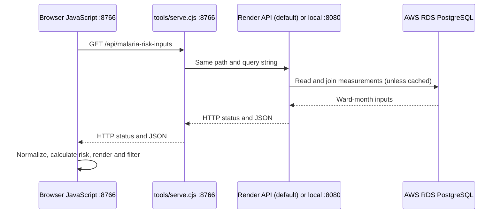

# EOHA — Earth Observation Health Analytics

EOHA is the Medical Consortium of Africa's prototype for exploring environmental
measurements and malaria risk across South African wards. The frontend uses plain
HTML, CSS and JavaScript. The Spring Boot API is hosted on Render and reads AWS RDS
data; running that API locally remains an optional development configuration.
The application server, API forwarding and repository checks use JavaScript/Node.js.
There is no frontend build step or Python requirement to run the frontend.

## Choose a hosted or local API

The default mode is **Auto: hosted first, then local on a temporary outage**. The browser still calls relative
`/api/...` URLs on the frontend server; Node forwards those requests to the
selected backend. This avoids depending on browser CORS permission from Render.

| Mode | Frontend command | API origin used by Node | Local Java/RDS configuration needed? |
| --- | --- | --- | --- |
| Auto (default) | `npm start` / `npm run start:auto` | Hosted first, then local on an outage | Local is needed only if fallback is used |
| Hosted (explicit) | `npm run start:hosted` | `https://eoha-backend.onrender.com` | No |
| Local (optional) | `npm run start:local` | `http://127.0.0.1:8080` | Yes, on the local backend |

Run one frontend server at a time on port 8766. Stop it with Ctrl+C before changing
modes. Each new page load uses the source selected when that server started;
manual Hosted/Local modes never switch sources. Auto falls back only for connection
failures, timeouts and HTTP 502/503/504, never to CSV.

### Start the frontend; choose the source in the browser

From this repository's root with Node.js 18 or newer:

```bash
npm start
# Auto explicitly: hosted → local if the hosted service is unavailable
npm run start:auto
# Explicit hosted-only process default:
npm run start:hosted
# Equivalent without npm:
node tools/serve.cjs --api hosted
```

Open [the prototype](http://localhost:8766). Its Node.js server uses only built-in
modules; no `npm install`, local Java process or local database credentials are
needed to use the hosted API. Auto can fall back to local only if that backend is running. The API must already be running and
correctly configured on Render.

### Local API: optional development setup

In one terminal, start the sibling backend with Java 21:

```bash
cd ../eoha_backend
bash mvnw spring-boot:run
```

The local backend loads its ignored `.env.local`, using `DB_HOST`, `DB_PORT`,
`DB_NAME`, `DB_USER`, `DB_PASSWORD` and `DB_SSLMODE`. Keep credentials there,
not in frontend files. Then, from the prototype root in another terminal:

```bash
npm run start:local
# Equivalent:
node tools/serve.cjs --api local
```

### Configuration and overrides

`config/api.json` is the single place for the two named backend origins:

```json
{
  "defaultTarget": "auto",
  "browserSelectionEnabled": true,
  "autoOrder": ["hosted", "local"],
  "targets": {
    "hosted": "https://eoha-backend.onrender.com",
    "local": "http://127.0.0.1:8080"
  }
}
```

`--api hosted|local|auto` selects the process default. An explicit `--backend URL` overrides
that profile's origin for the current process. The URL must be an HTTP(S) origin,
without credentials, a path or query. Unknown profile names fail at startup.

```bash
node tools/serve.cjs --port 8767 --api hosted
node tools/serve.cjs --backend https://eoha-backend.onrender.com
node tools/serve.cjs --backend http://127.0.0.1:8080
node tools/serve.cjs --help
```

The startup log prints the process default and first upstream. `scripts/shared/api-config.js`
keeps `baseUrl: '/api'` for both modes; do not put an absolute Render origin
there unless the deployed backend has enabled CORS for your frontend origin.
Plain static hosting does not run this proxy: configure a hosting reverse proxy
or run this Node.js service alongside the static pages.

### Optional browser selector and future removal

The malaria dashboard and reports show an **API source** selector with Hosted,
Local and Auto. Auto always starts with Hosted. The adjacent source label shows
which backend actually returned the response, including a Local fallback.
Changing the selector saves the named choice under `eoha-api-target`, updates the
page's `?api=hosted|local|auto` preference and reloads the whole page. This discards
the previous source's dataset. Storage-blocked browsers still work using the query
parameter for the current page.

Browser choices override the process default only when
`browserSelectionEnabled: true`. An explicit custom `--backend URL` pins that
origin and hides the selector. The server accepts only configured named modes,
never an arbitrary browser-provided upstream URL.

To retire selection later, set `config/api.json` to:

```json
{
  "defaultTarget": "hosted",
  "browserSelectionEnabled": false,
  "targets": {
    "hosted": "https://eoha-backend.onrender.com"
  }
}
```

Restart the Node.js server. It hides the selector and ignores stale saved choices,
query preferences and browser source headers. All requests use the configured
process default. No scoring, normalization, map or report changes are needed.
You may then delete the optional selector markup, stylesheet and
`scripts/shared/api-selector.js` script tags; the normal loader still uses
`/api/...`. `tools/api-source.cjs` isolates the server-side routing policy from
static serving and page/data code.

Auto retries only before forwarding a response body, so one dataset never combines
hosted and local records. A hosted timeout/network failure or HTTP 502/503/504 can
trigger Local; 400/401/403/404, invalid JSON and incomplete data stay visible rather
than being hidden by source switching. Auto allows 25 seconds of upstream socket
inactivity per attempt; manual modes retain 60 seconds. The browser data-load limit
is 60 seconds. Localhost refers to the machine running Node, not a visitor's laptop
when Node is deployed online.

The frontend-only `GET /api-settings` route supplies this policy to the selector;
it is not a Render backend endpoint. Browser selection is sent as
`X-EOHA-API-Target: hosted|local|auto`; response headers
`X-EOHA-API-Source` and `X-EOHA-API-Mode` report the resolved source and mode.
Direct API tabs and plain `fetch()` requests use the process default. To respect
the browser's selected mode in custom browser code, use the optional wrapper:

```js
const apiFetch = window.EOHA_API_SOURCE?.fetch || window.fetch.bind(window);
const response = await apiFetch('/api/environmental-variables');
const body = await response.json();
console.table(body.data.items);
```

### Hosted deployment requirement

On 30 October 2026, the Render health/database and environmental-variable requests
succeeded after an initial transient database error, but
`https://eoha-backend.onrender.com/api/malaria-risk-inputs` returned **404**.
Malaria scoring needs that joined endpoint; the variables catalogue alone cannot
supply scored ward records. Deploy the backend implementation containing
`MalariaRiskInputController` and `MalariaRiskInputService`, then restart/redeploy
Render. Until it exists, the frontend shows deployment guidance rather than silently hiding a missing endpoint. Select Local manually if a
working local backend is available; a 404 deliberately does not trigger Auto fallback. These classes are present in the local
backend integration changes described below; updating frontend configuration does
not deploy them to Render.

## Feature folders

Pages, scripts and styles use matching feature names. A file named `dashboard`
belongs to that feature's dashboard; reusable behavior belongs in `shared`.

```text
eoha-prototype/
├── index.html                       # Landing page
├── package.json                     # Start/test commands; optional browser-test dependency
├── package-lock.json                # Pinned development dependency tree
├── pages/
│   ├── malaria/
│   │   ├── dashboard.html           # Live API map and ward risk
│   │   ├── reports.html             # Live API filtering, table and export
│   │   ├── forecasting.html         # Forecast endpoint unavailable
│   │   └── resources.html
│   ├── ncd/
│   │   ├── dashboard.html           # Historical environmental measurements
│   │   ├── reports.html             # NCD scoring endpoint unavailable
│   │   ├── forecasting.html         # Forecast endpoint unavailable
│   │   └── resources.html
│   └── contact/index.html
├── scripts/
│   ├── malaria/
│   │   ├── api.js                   # Request, normalize and score API records
│   │   ├── dashboard.js             # Dashboard initializer
│   │   ├── dashboard/               # Config, data, dropdowns, events, map, risk, UI
│   │   └── reports.js               # Report loading, filtering, sorting and export
│   ├── ncd/
│   │   ├── dashboard.js             # Historical observation map and controls
│   │   ├── data.js                  # Missing-value handling, filters and means
│   │   └── regions.js               # Country/province navigation metadata
│   ├── contact/index.js
│   ├── shared/                      # API config, theme, map theme, resource filters
│   └── vendor/                      # Unmodified third-party browser libraries
├── styles/
│   ├── malaria/                     # dashboard.css and reports.css
│   ├── ncd/dashboard.css
│   ├── contact/index.css
│   ├── home/index.css
│   └── shared/                      # Theme, components, mobile and resources
├── assets/
│   ├── icons/
│   ├── images/
│   └── video/
├── data/
│   ├── malaria/                     # Retained historical observation CSVs
│   └── shared/                      # Country and province GeoJSON boundaries
├── schemas/ncd/risk-record.schema.json
├── config/
│   ├── api.json                     # Sources, default mode and optional selector
│   └── routes.json                  # Old page URL → canonical page URL
├── tools/
│   ├── serve.cjs                    # Static server, settings and redirects
│   ├── api-source.cjs               # Isolated source selection and Auto failover
│   └── data-pipeline/               # Real Earth Engine extraction utility
├── tests/
│   ├── malaria/                     # API unit, browser and live RDS checks
│   ├── ncd/                         # Historical observation helper tests
│   ├── shared/                      # Themes, layouts, resources and redirects
│   └── repository/                  # Local references and demo-removal checks
└── docs/
    ├── malaria/api-integration.md
    ├── ncd/risk-scoring.md
```

Static unavailable pages do not have empty or artificial JavaScript files. Add a
feature script when the backend supplies real behavior for that page. Styles
shared by those pages live in `styles/shared/resources.css`.

## Current behavior

| Feature | Data and behavior |
| --- | --- |
| Malaria dashboard | Live API measurements, risk heatmap, region/ward selectors and observation timeline |
| Malaria reports | The same live measurements and formula, filters, sorting, 25 rows per page and full filtered CSV export |
| NCD dashboard | Real historical CSV measurements and geographic boundaries; NCD scores remain unavailable |
| Forecasting | Explicit unavailable states until a forecasting endpoint/model exists |
| NCD reports | Explicit unavailable state until validated NCD scoring exists |
| Resource centers | Shared category filtering and links to retained data/specifications |
| Contact | Organisation details and the location map |

All synthetic NCD datasets, reference data, demo score calculations, synthetic
projection code and data generators have been removed. Fabricated malaria forecast
series and their uncertainty bands have also been removed. Test fixtures stay in
`tests/` and are never loaded by the application. The real Earth Engine extractor
in `tools/data-pipeline/` is retained; it does not generate demo data.

## How the frontend reaches the backend

The browser runs JavaScript from the HTML pages. The Node.js server runs separately
on your computer and handles static files and API forwarding. By default the
backend is the Render-hosted Java/Spring Boot application; `start:local` selects
the optional local backend instead. Database credentials stay on the backend.



Previously, the Python preview server provided this same-origin forwarding as a
local development convenience. `tools/serve.cjs` now performs that job in JavaScript
using Node's built-in HTTP/HTTPS, filesystem and stream modules. The Python proxy
has been removed.

You can inspect data through the selected proxy or directly on either backend:

| Access | Example | Intended use |
| --- | --- | --- |
| Through the JavaScript frontend server | `http://localhost:8766/api/environmental-variables` | Browser pages, the browser console and frontend code |
| Directly on Render | `https://eoha-backend.onrender.com/api/environmental-variables` | Inspect the hosted JSON without the frontend |
| Directly on local Spring Boot (optional) | `http://localhost:8080/api/environmental-variables` | Inspect/test a locally running backend |

The variables URL on Render displays hosted JSON directly. On port 8766, the same
path returns data from the selected source (Render by default). Opening `/` on
port 8766 displays the frontend home page; opening the chosen backend origin
itself displays backend status.

The frontend uses relative `/api/...` URLs, keeping requests on its own origin.
This avoids a cross-origin browser request in the default setup. Direct browser
fetches to Render or from port 8766 to port 8080 require a suitable backend CORS policy. Setting
a frontend URL alone does not configure backend CORS.

## Complete current API endpoint catalogue

These are the routes defined by the backend integration contract. The deployed
Render version must include each controller; the joined malaria endpoint was
not yet deployed at the verification date noted above. Data
access is read-only. The JavaScript proxy accepts GET and HEAD and rejects write
methods with 405; use GET in frontend consumption code. There are no forecast or
validated NCD scoring endpoints in this backend version.

| Method | Backend route | Data/result location | Parameters / purpose |
| --- | --- | --- | --- |
| GET | `/` | Top-level `service`, `status` | Backend status; access directly on Render or optional local port 8080 |
| GET | `/api/health` | `body.data.status` | Application liveness; does not prove database readiness |
| GET | `/api/health/database` | `body.data` | Connectivity, required schema/tables, `connected` and `ready`; HTTP 200 when ready, 503 otherwise |
| GET | `/api/regions` | `body.data.items` | Ward/region metadata; `limit`, `offset` |
| GET | `/api/environmental-observations` | `body.data.items` | Individual variable measurements; `limit`, `offset` |
| GET | `/api/environmental-variables` | `body.data.items` | Variable codes, labels, units and categories; `limit`, `offset` |
| GET | `/api/data-sources` | `body.data.items` | Source codes, providers, datasets and resolutions; `limit`, `offset` |
| GET | `/api/etl-runs` | `body.data.items` | Extraction/load run times, status and record counts; `limit`, `offset` |
| GET | `/api/schema` | `body.data` (array) | Current columns/types/nullability/defaults for the five raw tables |
| GET | `/api/malaria-risk-inputs` | `body.data` (array) | Joined ward-month inputs consumed by malaria dashboard/reports; no pagination parameters |

All `/api/...` routes above can also be requested on port 8766. Useful browser links:
[variables](http://localhost:8766/api/environmental-variables),
[regions](http://localhost:8766/api/regions?limit=10&offset=0),
[observations](http://localhost:8766/api/environmental-observations?limit=10&offset=0),
[sources](http://localhost:8766/api/data-sources),
[ETL runs](http://localhost:8766/api/etl-runs),
[schema](http://localhost:8766/api/schema),
[database readiness](http://localhost:8766/api/health/database), and
[malaria inputs](http://localhost:8766/api/malaria-risk-inputs).

The joined malaria endpoint is implemented by the integration changes in the
sibling `eoha_backend` repository. A local or hosted backend that lacks this
controller returns 404 until that implementation is deployed. This currently
applies to the supplied Render deployment.

The backend implementation can be traced in the sibling repository:

| Backend source (relative to `eoha_backend/`) | Responsibility |
| --- | --- |
| `src/main/java/com/eoha/eoha_backend/controller/HealthController.java` | Root, application health and database readiness routes |
| `src/main/java/com/eoha/eoha_backend/controller/EohaDataController.java` | The five paginated raw resources and schema route |
| `src/main/java/com/eoha/eoha_backend/controller/MalariaRiskInputController.java` | Joined malaria input route |
| `src/main/java/com/eoha/eoha_backend/service/EohaTableService.java` | Whitelisted raw-table reads, pagination and column discovery |
| `src/main/java/com/eoha/eoha_backend/service/MalariaRiskInputService.java` | Ward-month SQL projection, unit checks/conversions and 60-second in-memory cache |
| `src/main/java/com/eoha/eoha_backend/service/DatabaseHealthService.java` | Connection and required-table checks |
| `src/main/java/com/eoha/eoha_backend/dto/` | JSON success/error envelopes and paginated response records |

## Raw data, pagination and relationships

The five raw table endpoints use this envelope (shortened variable example):

```json
{
  "success": true,
  "data": {
    "items": [
      { "variable_id": 1, "variable_code": "lst_c", "variable_name": "Land Surface Temperature", "unit": "°C" }
    ],
    "total": 9,
    "limit": 1,
    "offset": 0
  },
  "message": null
}
```

Read the records from `body.data.items`, not from `body.items`. `total` counts all
records in that table; `items.length` counts this page only. Defaults are
`limit=100` and `offset=0`. `limit` must be between 1 and 500; `offset` must be
nonnegative. An offset past the end produces an empty page. Invalid pagination
values produce a 400 response. These endpoints currently expose pagination only,
not province, region, variable or date query filters.

| Raw resource | Main fields and relationships |
| --- | --- |
| Regions | `region_id`, `region_code`, `region_name`, `region_type`, `parent_region_id`, `province`, `geometry` |
| Observations | `observation_id`, `region_id`, `variable_id`, `data_source_id`, `observation_month`, `statistic`, `value`, quality/sample fields, `etl_run_id`, `metadata` |
| Variables | `variable_id`, `variable_code`, `variable_name`, `unit`, `category`, `description` |
| Sources | `data_source_id`, `source_code`, `source_name`, `provider`, `dataset_id`, `temporal_resolution`, `spatial_resolution`, `active` |
| ETL runs | `etl_run_id`, `pipeline_name`, run timestamps, `observation_month`, `status`, inserted/updated/failed counts, `metadata` |

Join an observation's `region_id` to a region, `variable_id` to a variable,
`data_source_id` to a source and optional `etl_run_id` to a run. Each observation
is one variable measurement, not an entire scored ward record. For the full current
field list, request `/api/schema`; the raw endpoints return the database row shape.
PostgreSQL JSON metadata can be returned as a JSON string by this backend. Inspect
its type before using it:

```js
const metadata = typeof observation.metadata === 'string'
  ? JSON.parse(observation.metadata)
  : observation.metadata;
console.log(metadata?.municipality, metadata?.latitude, metadata?.longitude);
```

Raw SQL DATE values can arrive as UTC timestamps whose displayed day differs from
the source calendar date. The joined malaria endpoint explicitly returns
`YYYY-MM-DD` text to preserve observation months; the production UI uses that field.

## Consume the APIs in JavaScript

Run these relative-URL examples in frontend code or the browser console while
viewing the prototype on port 8766:

```js
const response = await fetch('/api/environmental-variables?limit=100&offset=0');
if (!response.ok) throw new Error(`API request failed: ${response.status}`);
const body = await response.json();
if (!body.success) throw new Error(body.message || 'API rejected the request');
const variables = body.data.items;
console.table(variables);
```

For health or schema, the data shape is different:

```js
const healthResponse = await fetch('/api/health/database');
const health = await healthResponse.json();
console.log(healthResponse.status, health.data?.connected, health.data?.ready);

const schemaResponse = await fetch('/api/schema');
if (!schemaResponse.ok) throw new Error('Schema request failed');
const schema = await schemaResponse.json();
console.table(schema.data); // Array of column descriptions, without .items
```

To read every page of a small raw resource, advance the offset by the number of
returned items until the total is reached. Avoid this approach for the full large
observation table when the joined malaria endpoint already supplies the UI inputs:

```js
const allVariables = [];
let offset = 0;
while (true) {
  const response = await fetch(`/api/environmental-variables?limit=500&offset=${offset}`);
  if (!response.ok) throw new Error(`API request failed: ${response.status}`);
  const body = await response.json();
  if (!body.success) throw new Error(body.message || 'API request failed');
  const page = body.data;
  allVariables.push(...page.items);
  if (allVariables.length >= page.total) break;
  if (!page.items.length) throw new Error('Incomplete paginated response');
  offset += page.items.length;
}
console.table(allVariables);
```

Outside the browser, Node.js fetch needs an absolute URL. Run this example in the
Node REPL (`node`) or an ES-module `.mjs` file, both of which support top-level await:

```js
const response = await fetch('http://localhost:8766/api/environmental-variables');
if (!response.ok) throw new Error(`API request failed: ${response.status}`);
const body = await response.json();
console.log(body.data.items);
```

## The malaria endpoint and frontend data locations

`/api/malaria-risk-inputs` returns an envelope with an array directly under `data`:

```json
{
  "success": true,
  "data": [
    {
      "region_id": 2,
      "region_code": "93301001",
      "region_name": "LIM331_1",
      "province": "Limpopo",
      "municipality": "Greater Giyani Local Municipality",
      "latitude": -23.3699,
      "longitude": 30.3578,
      "observation_month": "2026-01-01",
      "lst_c": 25.1,
      "soil_moisture": 0.3518,
      "ndwi": -0.1342,
      "population_density_per_km2": 547.6,
      "air_temp_c": 22.58,
      "agric_percentage": 0.39
    }
  ],
  "message": null
}
```

The backend groups mean observations by ward/month, joins source and variable
metadata, and extracts municipality/coordinates from observation metadata. It
keeps required inputs null if units are unsupported or measurements are ambiguous.
It converts WorldPop mean counts per 100 m pixel to approximate persons/km² by
multiplying by 100, matching the existing pipeline convention. Agriculture fractions
are multiplied by 100 for percentage display. This is one read-only data projection,
not a forecast model and not a database write operation.

| Received API field | Normalized frontend field |
| --- | --- |
| `region_code` (or `region_id` fallback) | `WardID` |
| `region_name` | `WardLabel` |
| `municipality` | `Municipali` |
| `province` | `Province` |
| `latitude`, `longitude` | `latitude`, `longitude` |
| `observation_month` | `date` and a `Month` label such as `Jan 2026` |
| `lst_c` | `LST_Surface_C` |
| `soil_moisture` | `Soil_Moisture` |
| `ndwi` | `NDWI_Water` |
| `population_density_per_km2` | `Population_Density_Per_KM2` |
| `air_temp_c`, `agric_percentage` | `Air_Temp_C`, `Agric_Percentage` |

The application receives and uses that response here:

| File / function | Responsibility and data access |
| --- | --- |
| `scripts/shared/api-config.js` | `/api` base URL, `/malaria-risk-inputs` endpoint and 60-second browser timeout; the server selects the hosted/local upstream |
| `tools/api-source.cjs` → `forward()` | Forward the path/query to the hosted/default or explicit local/custom backend; stream its status and JSON back |
| `scripts/malaria/api.js` → `load()` | `fetch()`, HTTP/envelope validation, normalization and `{ rows, excluded }` result |
| `scripts/malaria/api.js` → `normalize()` | Map fields, validate dates/numbers and exclude incomplete required inputs |
| `scripts/malaria/api.js` → `score()` | Apply the existing four-factor formula in browser JavaScript |
| `scripts/malaria/dashboard/data.js` → `load_risk_data()` | Store records in `all_risk_data`, group `district_lookup`, build months and render hotspots |
| `scripts/malaria/dashboard/map.js` | Filter loaded records for the active map view and create markers/heat points |
| `scripts/malaria/reports.js` → `initialize_reports_page()` | Store scored records in `allData`; keep matching records in `tableData` |
| `scripts/malaria/reports.js` → `applyFilters()`, `renderTable()`, `exportCSV()` | Filter locally, sort/paginate 25 rows, export every matching record |

After the shared config and API scripts have loaded on a malaria page, this is the
preferred way to obtain ready-to-use records:

```js
const { rows, excluded } = await EOHAMalariaAPI.load();
console.log('Complete records:', rows.length, 'Excluded records:', excluded);
console.log(rows[0]);
console.log('Risk score:', EOHAMalariaAPI.score(rows[0]));
```

To inspect data without changing code, open browser developer tools → Network,
reload a malaria page, select `malaria-risk-inputs`, and view its Response. The
request URL should use port 8766 in the default setup. You can also open any API
link above in a browser tab, or use `fetch()` and `console.table()`.

Records are held in page memory, not persisted in localStorage or a frontend
database. Each page loads on opening. Changing month, municipality, risk filters,
sorting or report pagination uses the loaded data without another API request.
There is no polling: reload/reopen or change the source selector to request data again. The backend's 60-second
cache can reuse measurements until it expires; the Node.js proxy itself does not
cache API responses. Cold queries over the full dataset can take several seconds.

## Risk scoring and unavailable data

The existing formula remains unchanged:

| Factor | Condition | Points |
| --- | --- | ---: |
| Soil moisture | Above 0.35 | 40 |
| Soil moisture | Above 0.25 through 0.35 | 20 |
| Surface temperature | 25–30°C inclusive | 30 |
| NDWI | Above −0.1 | 20 |
| Population density | Above 300 persons/km² | 10 |

Scores of 50 or more are High; 25–49 Moderate; below 25 Low. All four inputs must
exist; missing values are not replaced with zero. Map records also need valid
coordinates. Optional air temperature/agriculture values can be unavailable without
inventing replacements. A score is calculated in the shared frontend module after
the backend supplies the measurements.

The NCD dashboard currently reads the retained historical CSV in
`data/malaria/Limpopo_Risk_Jan25_Jan26_Safe.csv` through `scripts/ncd/dashboard.js`.
It does not consume the malaria endpoint or compute NCD exposure scores.
Forecasting and NCD reports remain unavailable until their real backend interfaces
are implemented. No demo or fabricated data is substituted.

## Failures, diagnostics and deployment

| Symptom / HTTP status | Meaning and next check |
| --- | --- |
| Frontend will not start / `EADDRINUSE` | Port 8766 is occupied; stop the previous preview or choose `--port` |
| 502 from the Node.js proxy | Selected backend connection failed; check Render availability, or start local Spring Boot if local mode was selected |
| 504 from the Node.js proxy | Upstream socket was inactive for 60 seconds; inspect backend/query health |
| 503 from backend data or database health | Database is not ready or a query failed; inspect `/api/health/database` and backend logs |
| 400 on a raw list endpoint | Invalid `limit`/`offset`; use a limit from 1–500 and a nonnegative offset |
| 404 on `/api/malaria-risk-inputs` | The selected hosted/local backend lacks the joined endpoint implementation; deploy the scoring-input controller/service |
| 405 from the proxy | A write method was attempted; only GET/HEAD are forwarded |
| API succeeds but no scoring records | Required measurements, units or ward/municipality metadata are incomplete |
| Browser CORS error with a direct backend URL | Ports/origins differ; use relative `/api` through Node or configure backend CORS |

Service validation/query failures normally use
`{ "success": false, "data": null, "message": "..." }`; database health can include
its diagnostic object in `data` even with `success: false`. Framework-level errors
can have a different body. Always check HTTP status before assuming a success shape.
The proxy preserves backend status codes and does not turn a database failure into
a successful empty response. The UI displays a load error and does not fall back to CSV.

Manual modes never switch automatically. Auto can retry temporary hosted failures
on local; the source label and response header identify the backend used.
The frontend server reads no database credentials and sends no browser Authorization
header or cookies to the backend. The current local API has no application login
flow. Production authentication/access policy is a separate backend/deployment
concern. Keep local RDS configuration only in the backend's ignored `.env.local`; configure
hosted database settings in Render's environment configuration.

For deployment, run this Node.js service behind HTTPS or configure the web host to
serve the static files and proxy `/api` to the backend. If an absolute API origin is
used in `scripts/shared/api-config.js`, use HTTPS and configure backend CORS for the
frontend origin. Static hosting alone does not execute this Node.js proxy or apply
`config/routes.json` redirects. See [API integration](docs/malaria/api-integration.md)
and [NCD scoring requirements](docs/ncd/risk-scoring.md) for implementation details.

## Readable code and function comments

Use descriptive names, two-space indentation for JavaScript, and one clear task
per function. Named JavaScript functions use this comment format, with accurate
parameter types and return values:

```js
/**
 * update_card_stack_and_progress()
 * --------------------------------
 * Calculates scroll progress inside the stack section,
 * updates the vertical progress bar, and applies above/active/below
 * classes to each card.
 *
 * Parameters:
 * -----------
 * none
 *
 * Returns:
 * --------
 * void
 */
```

Document purpose and behavior, including missing-value handling and side effects.
Keep short event callbacks next to the operation they trigger. The optional offline
Earth Engine extraction utility is separate from the application and still uses Python
with equivalent purpose/Parameters/Returns docstrings. Vendor files retain their
original third-party source and licensing.

HTML owns markup, CSS owns presentation and JavaScript owns behavior. Resource
filtering has been extracted from inline HTML into `scripts/shared/resources.js`.
Load the shared theme script in the page head before first paint, and load the
malaria dashboard helper scripts before its `dashboard.js` initializer.

## Checks

Run from the repository root:

```bash
npm test
```

The test command runs 33 JavaScript checks for API mapping, historical data, local
references, redirects, proxy responses, failure/timeout handling and static serving.
For browser checks, install the pinned development dependency and Chromium once,
then keep the Node.js preview running in another terminal:

```bash
npm ci
npx playwright install chromium
npm run test:browser
# Requires the selected backend to expose malaria-risk-inputs and connect to RDS:
# Use npm run start:local until the joined endpoint is deployed on Render.
npm run test:live
```

Playwright is a development-only dependency. The preview/proxy and `npm test` use
only built-in Node.js modules and can run before installing development packages.

Browser checks cover the migrated routes, desktop/tablet/mobile layouts, both
themes, asset loading, filters, export, unavailable states and old URL redirects.
`EOHA_URL` and `BROWSER_EXECUTABLE` can override the preview URL and browser binary.
The live test verifies RDS-backed malaria scoring without mocking API requests.

## Navigation and deployment

Canonical routes are under `pages/malaria/`, `pages/ncd/` and `pages/contact/`.
The local preview redirects old bookmarks, for example
`/pages/malaria-reports.html` → `/pages/malaria/reports.html`, using
`config/routes.json`. Configure the same redirects on a production static host;
the JSON file alone does not make a static host redirect requests.

When adding a page, keep its HTML in `pages/<feature>/`, its behavior in
`scripts/<feature>/` and its styles in `styles/<feature>/`. Use relative links from
the actual page location, reuse shared theme tokens and update navigation and
structural/browser checks. Reusable data and assets belong in their corresponding
feature folder or `shared/`.
